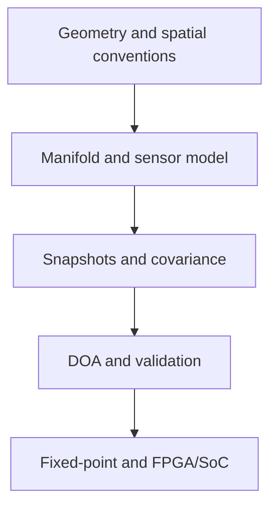
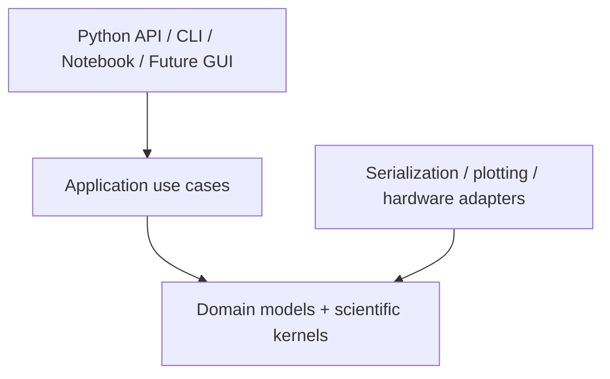
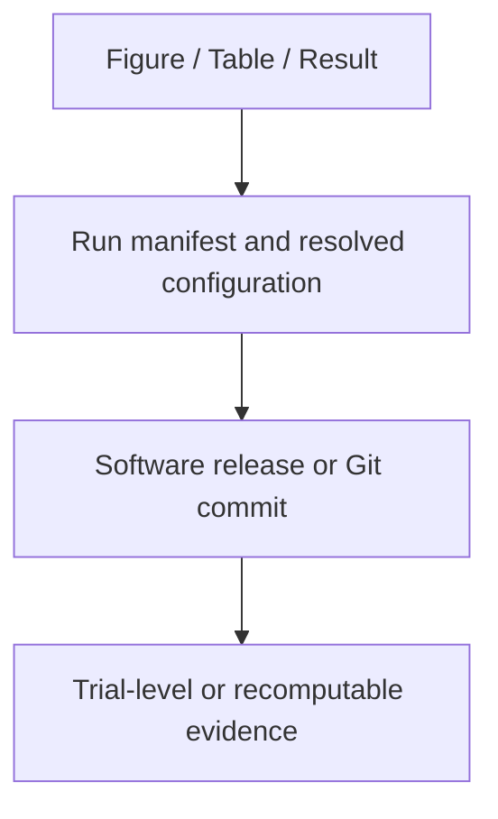
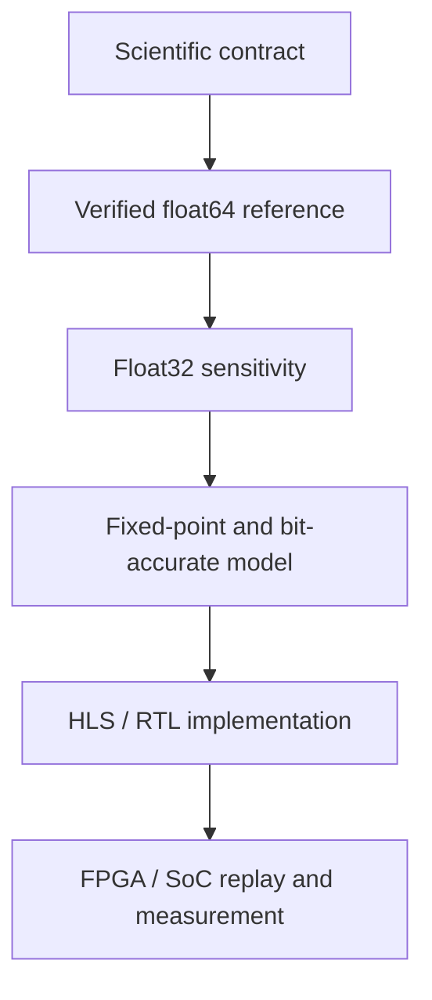
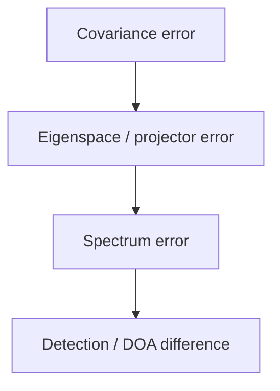

# GeoDOA Studio

[](https://github.com/hmolhem/geodoa-studio/actions/workflows/ci.yml)
[](https://www.python.org/)
[](docs/handoffs/PHASE0C_SCIENTIFIC_FOUNDATIONS_HANDOFF.md)

**An engineering-first research software workbench for geometry-aware sensor-array modeling, MIMO/DOA analysis, reproducible simulation, and FPGA/SoC co-design.**

> **Current status:** repository foundations, the Python engineering toolchain,
> and the initial scientific contracts are complete. Authoritative Phase-1
> scientific implementation is beginning. No stable scientific API or production
> release is available yet.

## Vision

GeoDOA Studio is being developed as a long-lived scientific and engineering
platform for studying how physical array geometry, propagation assumptions,
sensor behavior, numerical algorithms, statistical validation, and hardware
implementation affect direction-of-arrival results.

The project is not intended to be only a MUSIC demonstration, a collection of
research scripts, or a plotting-oriented GUI. Its goal is to provide a traceable
path from physical modeling to reproducible software evidence and, eventually,
to fixed-point and FPGA/SoC deployment.

GeoDOA is an independent project. Its core identity and roadmap are not tied to
any institution, employer, paper, or single experiment. External activities may
consume a versioned GeoDOA capability without defining the product itself.

## Engineering Scope

The following table describes the **intended product scope**. It must not be
interpreted as a list of currently implemented features.

| Area | Intended capability |
|---|---|
| Array geometry | Physical coordinates, persistent channel identity, custom and generated arrays, aperture, spacing, masks, lattice structure, and provenance |
| Spatial conventions | Angle and direction-cosine representations, broadside/endfire, visible sector, phase reference, projection ambiguity, and spatial aliasing |
| Manifold modeling | Ideal far-field narrowband steering first; later near-field, wideband, measured, calibrated, and EM-derived manifolds |
| Sensor modeling | Position, gain, phase, delay, coupling, receiver, sampling, and quantization effects through physically interpretable operators |
| Signal simulation | Reproducible source/noise scenarios, snapshot generation, covariance objects, and explicit statistical assumptions |
| Subspace and DOA | Eigenstructure diagnostics, Bartlett, MVDR/Capon, MUSIC, and later compatible subspace, coarray, and sparse estimators |
| Sparse and MIMO arrays | Difference coarrays, lag multiplicities, contiguous virtual aperture, Tx/Rx provenance, and virtual-array construction |
| Validation | Golden Reference verification, Monte Carlo studies, bias/variance/MSE/RMSE, detection/resolution evidence, failures, and uncertainty |
| Hardware co-design | Float64-to-float32-to-fixed-point traceability, test-vector exchange, backend equivalence, HLS/RTL, and FPGA/SoC evidence |
| Interfaces | A shared validated core for the Python API, CLI, notebooks, a future GUI, and hardware adapters |

## End-to-End Engineering Chain



The same scientific definitions and verified application services should support
headless experiments, automated tests, future interactive workflows, and
alternate numerical or hardware backends.

## Current Implementation Status

| Capability | State |
|---|---|
| Repository structure and governance | Complete — Phase 0A closed |
| Python packaging and engineering toolchain | Complete — Phase 0B closed |
| Ruff, mypy, pytest, and GitHub Actions matrix | Operational on Python 3.12, 3.13, and 3.14 |
| Scientific contracts ADR-001 through ADR-004 | Accepted — Phase 0C closed |
| Golden Reference Problem definitions GRP-001 through GRP-018 | Established as independent scientific evidence |
| Initial validation profile VP-001 | Accepted as the governed Phase-1 target |
| Production geometry and manifold kernels | Not yet implemented |
| Snapshot, covariance, eigenspace, and DOA kernels | Not yet implemented |
| Monte Carlo engine and publication evidence pipeline | Not yet implemented |
| CLI, GUI, and notebook workflows | Not yet implemented |
| Fixed-point model and FPGA/SoC backend | Not yet implemented |

The repository currently contains an importable `geodoa` package bootstrap and
its engineering infrastructure. Documentation maturity must not be mistaken for
implemented scientific capability.

## Initial Scientific Baseline

The governed first scientific profile is:

```text
VP-001 — Phase-1 Ideal Far-Field Narrowband 1-D DOA Validation Profile
```

Its baseline measurement model is

$$
\mathbf X = \mathbf A\mathbf S + \mathbf N,
$$

and, for the declared known-zero-mean baseline, the default sample object is the
uncentered second moment

$$
\hat{\mathbf R}_0 = \frac{1}{L}\mathbf X\mathbf X^H.
$$

Mean-centered sample covariance is a different object and will not be substituted
silently. The initial profile is deliberately limited to an ideal, scalar,
uncoupled, one-dimensional physical array under far-field narrowband assumptions.

## Phase-1 Delivery Strategy

VP-001 is a validation profile, not one large pull request. Implementation will
proceed through bounded, testable slices:

1. validated custom/ULA geometry and canonical configuration;
2. physical and difference-coarray analysis;
3. deterministic far-field narrowband steering/manifold computation;
4. seeded snapshot generation and float64 second-moment reference;
5. verified eigenspace processing and oracle-source-count MUSIC;
6. association, metrics, typed failures, provenance, and a small reproducible benchmark;
7. additional estimators, geometry families, user interfaces, and hardware adapters only after the reference path is trusted.

Each slice must define its requirements, scientific oracle, typed interfaces,
boundary behavior, tests, limitations, and reproducibility evidence before merge.

## Engineering Principles

- **Headless scientific core:** GUI callbacks and notebooks are not the source of truth.
- **Explicit semantics:** units, coordinates, direction conventions, phase reference, shapes, ordering, and normalization are never inferred silently.
- **Typed domain behavior:** invalid, incompatible, ambiguous, unresolved, and numerical-failure outcomes remain visible evidence.
- **Independent verification:** production output cannot be its own only oracle.
- **Reproducibility:** important results retain resolved configuration, version/commit, random-stream identity, policies, backend, precision, and artifact hashes.
- **Layered architecture:** domain and numerical kernels remain independent of GUI frameworks, plotting libraries, storage, and hardware control.
- **Incremental delivery:** one bounded engineering use case per reviewed work package; no feature accumulation through mega-PRs.
- **Honest claims:** software agreement, simulation validation, hardware integration, and physical-array validation are distinct evidence levels.

## Scientific Reference Program

The Golden Reference Problems provide hand-checked or independently derived
scientific evidence for later implementation tests.

They currently cover:

- propagation delay and steering phase;
- translation and phase-reference behavior;
- projection ambiguity and spatial aliasing;
- lattice and difference-coarray construction;
- far-field and narrowband diagnostics;
- covariance, eigendecomposition, sample rank, and MUSIC orthogonality;
- position error, gain/phase mismatch, and mutual coupling;
- covariance/eigenspace distortion;
- bias, variance, MSE, and RMSE.

Monte Carlo agreement does not replace deterministic semantic verification.

## Software Architecture

GeoDOA follows a domain-centered architecture:



Object-oriented design is used where identity, invariants, policies, or lifecycle
matter. Pure numerical functions are preferred when a class would add no
scientific or engineering value. Authoritative implementation belongs under
`src/geodoa`, not inside notebooks.

## Development Setup

### Requirements

- Python 3.12, 3.13, or 3.14
- Git

### Create an environment and install

```powershell
python -m venv .venv
.\.venv\Scripts\Activate.ps1
python -m pip install --upgrade pip
python -m pip install -e ".[dev]"
```

On Linux or macOS, activate the environment with:

```bash
source .venv/bin/activate
```

### Run the engineering gate

```powershell
ruff check .
ruff format --check .
mypy src
pytest
```

The same quality gate runs in GitHub Actions for every pull request targeting
`main` and for pushes to `main`.

There is no scientific usage example yet because the authoritative Phase-1 core
has not been implemented. An executable example will be added with the first
verified vertical slice.

## Documentation Map

- [Master Start Handoff](docs/handoffs/GEODOA_STUDIO_MASTER_START_HANDOFF.md)
- [Milestone Handoff Index](docs/handoffs/HANDOFF_INDEX.md)
- [Phase 0C Scientific Foundations Handoff](docs/handoffs/PHASE0C_SCIENTIFIC_FOUNDATIONS_HANDOFF.md)
- [Scientific Contract Roadmap](docs/PHASE0C_SCIENTIFIC_CONTRACTS_ROADMAP.md)
- [Architecture Decision Records](docs/adr/)
- [Golden Reference Problems](docs/science/golden_reference/)

Accepted records and closed milestone handoffs are authoritative. Exploration
documents preserve their historical lifecycle and do not override later final
acceptance records.

## Research Use and Reproducibility

GeoDOA is intended to support independent, versioned research studies without
embedding paper-specific assumptions into the general-purpose core.

The target traceability chain is:



A study should identify the exact GeoDOA release or commit it used and retain
its scenario, random-stream policy, algorithms, metrics, failures, and generated
artifacts. Study-specific adapters and frozen profiles must not silently alter
the identity of published experiments.

A formal `CITATION.cff` and archival citation policy will be added with an
appropriate tagged research release. Until then, reproducible work should cite
the repository and the full commit SHA used.

## Hardware Co-Design Direction

The intended numerical implementation path is:



Backend validation should propagate numerical effects beyond raw matrix error:



Latency, initiation interval, throughput, resources, timing closure, and host
transfer time will remain separately identified engineering evidence.

## Scope Control

The project intentionally prioritizes a narrow, verified baseline before adding:

- near-field or wideband profiles;
- measured or CST-derived manifolds;
- coupling and calibration implementations;
- coherent-source remedies and model-order estimation;
- Coarray MUSIC, sparse estimators, or research-specific regularizers;
- broad geometry catalogs;
- large Monte Carlo campaigns;
- GUI expansion or hardware acceleration beyond accepted backend contracts.

Deferred capabilities are part of the long-term roadmap, not current promises.

## Project Governance

Engineering work uses bounded branches and pull requests with explicit scope,
acceptance criteria, verification, milestone handoff, merge, cleanup, and
resynchronization of `main`. Micro-actions do not require independent branches,
but unrelated work is not bundled into a single review.

## Author

**Hossein Molhem**
DSP, sensor-array modeling, MIMO/DOA estimation, and FPGA/SoC hardware-algorithm co-design

- [GitHub](https://github.com/hmolhem)
- [LinkedIn](https://www.linkedin.com/in/hossein-molhem/)

## License

The licensing policy has not yet been finalized. Until a `LICENSE` file is added,
no open-source license or permission to reuse, modify, or redistribute the source
is granted.