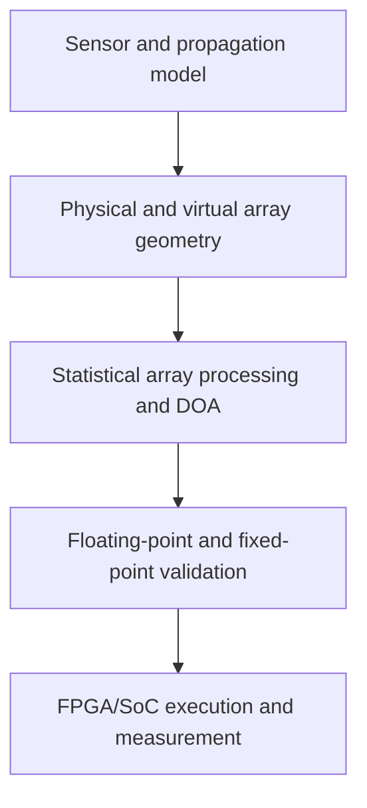
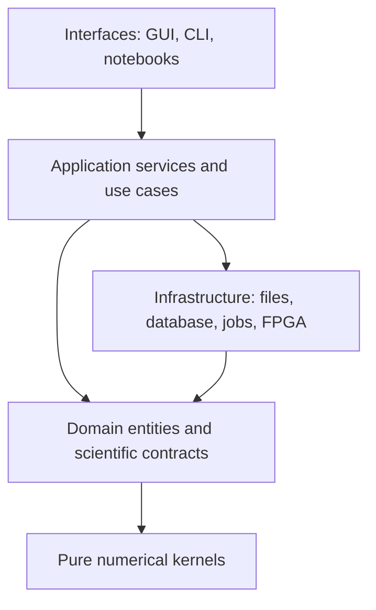

# GeoDOA Studio — Master Project Start Handoff

> **Recommended full title:** GeoDOA Studio: Geometry-Aware Sensor-Array Modeling, DOA Estimation, and Hardware Co-Design Workbench  
> **Recommended GitHub repository:** `geodoa-studio`  
> **Recommended Python package:** `geodoa`  
> **Recommended command-line entry point:** `geodoa`  
> **Owner:** Hossein Molhem  
> **Document role:** Authoritative project-start handoff and engineering charter  
> **Initial scientific scope:** One-dimensional sensor and MIMO arrays  
> **Architecture direction:** Object-oriented, modular, typed, testable, reproducible, GUI-enabled  
> **Status:** Initialization — no implementation decisions outside this document are yet authoritative  
> **Version:** 1.0  
> **Date:** 2026-08-21

---

## 1. Instructions to the Next Project Chat or Coding Agent

This file is the authoritative starting context for GeoDOA Studio.

Before writing or changing any code, the next agent must:

1. Read this document completely.
2. Inspect the target repository in read-only mode.
3. Report the current branch, working-tree status, file structure, CI configuration, and existing implementation.
4. Identify any conflict between the repository and this handoff.
5. Propose a small, reviewable Phase 0 implementation plan.
6. Wait for owner approval before making repository changes.

The next agent must not:

- copy the complete history or structure of `MIMO_GEOMETRY_ANALYSIS` into this project;
- alter frozen Paper 2 numerical definitions or results;
- place scientific algorithms directly inside GUI callbacks;
- implement all planned features in one pull request;
- add a geometry, metric, or DOA method without defining its assumptions and validation tests;
- make publication or novelty claims on behalf of the owner;
- work directly on `main` unless the owner explicitly authorizes it;
- silently change units, angle conventions, steering-vector signs, SNR definitions, or comparison constraints.

The Git repository, once initialized, is the persistent source of truth. This handoff defines the intended architecture and scope; later changes must be recorded through Architecture Decision Records and normal version-control history.

---

## 2. Naming Decision

### 2.1 Recommended product name

**GeoDOA Studio** is the recommended name.

It is:

- short and memorable;
- professional enough for publications, demonstrations, and a portfolio;
- not restricted to one array family;
- not restricted to MIMO-only processing;
- not restricted to MUSIC or ALSS;
- compatible with future sensor modeling and FPGA/SoC backends.

### 2.2 Recommended descriptive subtitle

> **Geometry-Aware Sensor-Array Modeling, DOA Estimation, and Hardware Co-Design Workbench**

### 2.3 Recommended repository and package names

| Item | Recommendation | Reason |
|---|---|---|
| GitHub repository | `geodoa-studio` | Short, discoverable, and consistent with the product name |
| Python distribution | `geodoa` | Convenient import name |
| Python import | `import geodoa` | Clear and compact |
| CLI command | `geodoa` | Suitable for scripted and headless workflows |
| GUI application label | `GeoDOA Studio` | Human-facing product identity |
| Documentation site title | `GeoDOA Studio Documentation` | Consistent public presentation |

Avoid putting `MIMO`, `GUI`, `ALSS`, or `MUSIC` in the repository name. Those terms describe important capabilities but would unnecessarily restrict the long-term identity of the framework.

### 2.4 Suggested tagline

> **From array geometry to validated DOA estimation and FPGA/SoC deployment.**

---

## 3. Mission and Professional Positioning

GeoDOA Studio will be the flagship integration project supporting the following professional identity:

> **Sensor Modeling and Array Signal Processing Engineer specializing in geometry-aware DOA estimation and FPGA/SoC acceleration.**

The project must demonstrate a complete engineering chain:



GeoDOA Studio is not intended to be only:

- a geometry plotting utility;
- a collection of unrelated MATLAB or Python scripts;
- an ALSS demonstration;
- a MUSIC tutorial;
- a decorative GUI;
- an FPGA project with no system-level reference model.

It must become a traceable engineering workbench in which the user can define a sensor-array system, inspect its geometry, simulate or import data, build a compatible processing pipeline, estimate DOAs, compare alternatives fairly, and export reproducible evidence.

---

## 4. Relationship to Existing Research and Repositories

### 4.1 `MIMO_GEOMETRY_ANALYSIS`

The existing repository is an upstream research reference, particularly for Paper 2, sparse-array geometries, coarray analysis, and ALSS-related work.

It must be treated as follows:

- read-only unless work is explicitly authorized in that repository;
- a source of verified scientific definitions and selected validated code;
- not a template whose complete history, CI problems, legacy scripts, or directory structure should be inherited;
- subject to whitelist-based migration: each migrated component must have provenance, tests, and an explicit reason for inclusion.

### 4.2 Frozen Paper 2 study

The current Paper 2 study is a frozen scientific artifact. Its established configuration includes:

- eight geometries;
- 112 publication conditions;
- 1,000 paired Monte Carlo trials per condition;
- ALSS mode `ar1`;
- `tau = 0.25`;
- `coreL = 3`.

GeoDOA Studio may later load, reproduce, visualize, or compare this study through a versioned study adapter. It must not silently retune, redefine, or overwrite the frozen study.

Exploratory variants must be saved as new configurations with explicit labels such as:

```text
paper2-frozen
paper2-reproduction
paper2-exploratory-clone
```

### 4.3 EE6800 FPGA/SoC project

The final-term EE6800 project remains a focused hardware–algorithm co-design project. It should not be expanded until it becomes responsible for delivering the entire GeoDOA Studio application.

Instead, it should eventually provide one or more verified hardware backends or kernels, for example:

- sample covariance matrix formation;
- coarray lag accumulation and averaging;
- Toeplitz virtual covariance construction;
- lightweight ALSS scalar processing;
- MUSIC spectrum scanning.

GeoDOA Studio will provide the floating-point reference, fixed-point comparison, configuration, visualization, and system-level validation around those kernels.

---

## 5. Non-Negotiable Engineering Principles

### 5.1 Scientific core independent of the GUI

The scientific core must run:

- from unit tests;
- from Python scripts;
- from notebooks;
- from the command line;
- from the GUI;
- eventually from a service or hardware backend.

No scientific result may depend on a Dash callback or browser state.

### 5.2 Object-oriented architecture without class inflation

The system must use object-oriented engineering where it improves domain modeling:

- immutable domain entities;
- typed value objects;
- interfaces or protocols for replaceable behaviors;
- composition of processing pipelines;
- dependency inversion for storage, GUI, and hardware backends;
- registries for geometry families, metrics, algorithms, and exporters.

Numerical kernels that are naturally pure array operations may remain pure functions. “Object-oriented” does not mean converting every equation into a stateful class.

### 5.3 Explicit conventions

Units, coordinates, sign conventions, angle definitions, covariance normalization, SNR definitions, source ordering, and comparison policies must never be implicit.

### 5.4 Reproducibility by construction

Every run must be traceable to:

- validated configuration;
- configuration hash;
- software version and Git commit;
- random seed or seed set;
- algorithm and geometry versions;
- input-data identity;
- numerical backend;
- warnings and failure status.

### 5.5 Fair comparisons

The framework must not silently compare arrays under inequivalent constraints. Each comparison must declare its fairness policy.

### 5.6 Assumption-aware execution

An algorithm may run only when its declared assumptions are compatible with the selected geometry, manifold, signal model, and preprocessing chain.

### 5.7 Progressive scope

The domain model should support future extension, but implementation must proceed through small vertical slices with measurable acceptance criteria.

---

## 6. Scientific Reference Model for the Initial 1-D Scope

### 6.1 Initial physical scope

The first scientific release targets arrays whose nominal sensor phase centers lie on one spatial axis.

The canonical internal position representation should nevertheless use an array with shape `(N, D)` so that future two-dimensional and three-dimensional extensions do not require redesigning every interface. For the initial release, `D = 1` is enforced at the domain boundary.

### 6.2 Canonical units

Recommended internal conventions:

- physical distance stored in meters;
- frequency stored in hertz;
- propagation speed stored in meters per second;
- wavelength derived as `propagation_speed / frequency`;
- normalized positions in wavelengths exposed as derived values;
- angles stored internally in radians and displayed optionally in degrees;
- time stored in seconds;
- power and SNR definitions represented explicitly, not inferred from a label.

If normalized positions are accepted as input, the reference wavelength or frequency must be provided before conversion to the canonical representation.

### 6.3 Coordinate and angle convention

Before implementing a steering vector, create an Architecture Decision Record that fixes:

- the array axis;
- the origin policy;
- broadside and endfire definitions;
- the positive-angle direction;
- the time-harmonic convention;
- the steering-vector phase sign;
- the visible angular sector;
- the spatial-frequency mapping.

A recommended initial convention is:

```math
a_n(\theta,f)
=
g_n(\theta,f)
\exp\!\left(-j\,\frac{2\pi f}{c}\,x_n\sin\theta\right),
```

where `theta = 0` denotes broadside. This equation is only a recommendation until approved and recorded in `ADR-001`.

### 6.4 Lattice and non-lattice geometries

The framework must distinguish:

- arbitrary real-valued linear positions;
- grid-based positions with a declared base spacing;
- approximately grid-aligned positions subject to a numerical tolerance.

Integer coarray lag indices are valid only after a lattice has been established. The code must not round arbitrary physical differences to integer lags without an explicit tolerance and validation decision.

### 6.5 Default wave model

The first validated processing chain may use a narrowband, far-field, plane-wave model. Near-field, wideband, dispersive, and moving-source capabilities belong to later milestones, but the configuration model must leave a clean extension point for them.

---

## 7. Comprehensive 1-D Array Engineering Requirement Catalog

This catalog defines the intended engineering coverage. It is deliberately broader than the first release. Requirements must be implemented in phases, not all at once.

Every requirement shall receive one of these states in a traceability table:

```text
planned | designed | implemented | verified | documented | deferred
```

### 7.1 Coordinate, unit, and reference parameters

| ID | Parameter or capability | Type | Engineering purpose |
|---|---|---|---|
| GEO-001 | Number of physical sensors `N` | Input | Hardware channel count and basic array size |
| GEO-002 | Ordered physical positions `x_n` | Input | Canonical definition of an arbitrary 1-D geometry |
| GEO-003 | Position input unit | Input | Prevents meter/wavelength/grid-index ambiguity |
| GEO-004 | Reference frequency `f_c` | Input | Defines wavelength and phase progression |
| GEO-005 | Propagation speed `c` | Input | Supports electromagnetic and future acoustic domains |
| GEO-006 | Reference wavelength `lambda_c` | Derived/validated input | Normalizes physical geometry |
| GEO-007 | Base lattice spacing `Delta` | Optional input/inferred | Enables integer lag indexing for grid arrays |
| GEO-008 | Lattice tolerance | Input | Controls numerical grid-alignment decisions |
| GEO-009 | Coordinate origin policy | Configuration | Defines canonicalization without changing physical behavior |
| GEO-010 | Array-axis direction | Configuration | Establishes coordinate and sign convention |
| GEO-011 | Broadside/endfire angle convention | Configuration | Prevents incompatible steering-vector definitions |
| GEO-012 | Positive-angle direction | Configuration | Ensures plot, simulation, and estimator consistency |
| GEO-013 | Steering phase-sign convention | Configuration | Prevents mirrored DOA estimates |
| GEO-014 | Sensor ordering policy | Configuration | Ensures deterministic serialization and pair indexing |
| GEO-015 | Duplicate-position policy | Validation | Rejects or explicitly models colocated channels |
| GEO-016 | Position uncertainty/tolerance | Input | Represents manufacturing or survey uncertainty |
| GEO-017 | Canonical geometry hash | Derived | Reproducibility and caching |
| GEO-018 | Translation-normalized positions | Derived | Supports invariant comparison |
| GEO-019 | Reflection-normalized representation | Optional derived | Detects mirror-equivalent geometries |
| GEO-020 | Geometry provenance and citation | Metadata | Separates published, custom, and optimized geometries |

### 7.2 Geometry-family construction parameters

The framework must use a geometry-generator registry. Geometry families generate the same immutable `LinearArrayGeometry` entity; they should not create incompatible geometry object hierarchies.

Initial and planned families include:

| ID | Family | Important parameters |
|---|---|---|
| FAM-001 | Custom linear array | Explicit positions, units, optional lattice spacing |
| FAM-002 | ULA | `N`, inter-element spacing, origin/centering policy |
| FAM-003 | Two-level nested array | Inner/outer counts and spacing convention |
| FAM-004 | Coprime array | Coprime integers, conventional/extended variant, subarray rule |
| FAM-005 | Minimum-redundancy/sparse-ruler array | Order, published solution identifier, provenance |
| FAM-006 | Super-nested or related nested variants | Variant-specific integer parameters and citation |
| FAM-007 | Weight-constrained arrays | Exact published construction, constraint set, version, citation |
| FAM-008 | Z-series arrays | Exact construction identifier; never reuse a published name for a nonidentical geometry |
| FAM-009 | User-imported geometry | CSV/JSON/YAML schema, units, provenance, validation policy |
| FAM-010 | Optimizer-generated geometry | Objective set, constraints, optimizer, seed, stopping status |

Each generator must expose:

- a machine-readable parameter schema;
- validation rules;
- a deterministic generator version;
- a human-readable mathematical definition;
- citations or provenance where applicable;
- reference examples with exact expected positions;
- compatibility metadata.

### 7.3 Physical geometry metrics

| ID | Metric | Definition or interpretation |
|---|---|---|
| MET-001 | Physical aperture | `max(x) - min(x)` in meters and wavelengths |
| MET-002 | Centroid | Mean sensor position |
| MET-003 | Minimum adjacent spacing | Closest sorted neighboring sensors |
| MET-004 | Maximum adjacent spacing | Largest physical gap |
| MET-005 | Mean adjacent spacing | Average sorted-neighbor separation |
| MET-006 | Median adjacent spacing | Robust central spacing measure |
| MET-007 | Spacing standard deviation/CV | Nonuniformity indicator |
| MET-008 | Unique adjacent spacings | Structural description |
| MET-009 | Unique pairwise baselines | Physical difference diversity |
| MET-010 | Sensor density | Sensor count relative to aperture |
| MET-011 | Grid occupancy/fill ratio | Fraction of lattice sites physically occupied |
| MET-012 | Symmetry residual | Distance from reflection symmetry about the centroid |
| MET-013 | Redundant physical coordinates | Duplicate or colocated channel diagnostic |
| MET-014 | Normalized aperture | Aperture divided by wavelength |
| MET-015 | Nearest-neighbor pair count | Coupling exposure indicator |
| MET-016 | Small-separation pair counts | Counts within configurable coupling-distance bands |
| MET-017 | Mechanical footprint | Physical span including optional element/package dimensions |
| MET-018 | Position tolerance margin | Minimum clearance relative to manufacturing tolerance |
| MET-019 | Geometry equivalence signature | Translation/reflection-aware identity diagnostic |
| MET-020 | Geometry complexity metadata | Number of subarrays, construction parameters, and regularity flags |

### 7.4 Physical element and channel parameters

These parameters distinguish a coordinate-only array from an engineering sensor model.

| ID | Parameter | Engineering purpose |
|---|---|---|
| PHY-001 | Element pattern model | Includes direction-dependent element response |
| PHY-002 | Element orientation | Allows consistent element-factor evaluation |
| PHY-003 | Per-channel complex gain | Models amplitude and phase calibration |
| PHY-004 | Gain error distribution | Monte Carlo manufacturing/receiver variation |
| PHY-005 | Phase error distribution | Calibration and RF-chain uncertainty |
| PHY-006 | Channel noise figure/noise variance | Sensor-specific noise behavior |
| PHY-007 | Sensor availability mask | Dead, disabled, or intermittent sensors |
| PHY-008 | Element bandwidth | Frequency-dependent applicability |
| PHY-009 | Polarization metadata | Future calibrated EM manifold support |
| PHY-010 | ADC resolution | Quantization effects |
| PHY-011 | ADC full-scale/dynamic range | Clipping and quantization model |
| PHY-012 | Sampling-rate metadata | Acquisition and hardware compatibility |
| PHY-013 | Clock/timing offset | Inter-channel synchronization error |
| PHY-014 | Carrier/LO phase offset | Receiver-chain coherence error |
| PHY-015 | Calibration state and timestamp | Traceability of measured arrays |

### 7.5 Difference-coarray parameters and metrics

For physical positions `x_i`, define the ordered difference multiset and unique difference set explicitly. For grid arrays, expose both physical lags and integer lag indices.

| ID | Metric or output | Engineering purpose |
|---|---|---|
| DCO-001 | Ordered sensor-pair map `(i,j)` | Traceability from covariance entries to lags |
| DCO-002 | Full ordered difference multiset | Preserves all `N^2` pair contributions |
| DCO-003 | Sorted unique difference lags | Defines the difference coarray |
| DCO-004 | Lag multiplicity `w[l]` | Number of covariance samples contributing to each lag |
| DCO-005 | Zero-lag multiplicity | Must equal `N` for a valid unique-sensor array |
| DCO-006 | Positive, negative, and nonnegative lag sets | Supports one-sided and Hermitian processing |
| DCO-007 | Difference-set symmetry check | Must satisfy lag/conjugate structure expectations |
| DCO-008 | Unique difference DOF | Number of distinct difference lags |
| DCO-009 | Positive-lag DOF | Useful one-sided measure |
| DCO-010 | Central contiguous segment | Largest hole-free segment containing zero |
| DCO-011 | One-sided contiguous segment | Start, end, and length on the nonnegative side |
| DCO-012 | Longest contiguous segment anywhere | Supports noncentral virtual subarray analysis |
| DCO-013 | Hole count and locations | Quantifies missing virtual lags |
| DCO-014 | Gap lengths and maximum gap | Describes coarray fragmentation |
| DCO-015 | Virtual aperture | Extreme usable or total coarray span, explicitly labeled |
| DCO-016 | Redundancy ratio | Ordered pairs relative to unique lags |
| DCO-017 | Minimum/maximum nonzero lag weight | Reliability extremes |
| DCO-018 | Lag-weight mean, variance, CV | Weight-imbalance diagnostics |
| DCO-019 | Low-weight lag fraction | Fraction below a declared reliability threshold |
| DCO-020 | Small-lag weights `w(1), w(2), w(3), ...` | Coupling sensitivity and WCSA diagnostics |
| DCO-021 | Weight entropy/Gini diagnostic | Optional nonstandard concentration diagnostic; label clearly |
| DCO-022 | Effective samples per lag | Snapshot count multiplied by lag multiplicity |
| DCO-023 | Lag-estimation variance proxy | Model-based proxy such as proportionality to `1/(M w[l])` |
| DCO-024 | Pair-index lookup table | Efficient reproducible lag accumulation |
| DCO-025 | Coarray compatibility flags | Contiguous, holed, central, one-sided, interpolation required |

Any distinction among total difference-set span, usable contiguous aperture, and reconstructed virtual aperture must remain explicit in names and plots.

### 7.6 MIMO and sum-coarray parameters

For colocated MIMO operation, transmit and receive arrays must remain explicit instead of being prematurely collapsed into a virtual array.

| ID | Parameter or metric | Engineering purpose |
|---|---|---|
| MIM-001 | Transmit positions | Defines the Tx array |
| MIM-002 | Receive positions | Defines the Rx array |
| MIM-003 | Tx/Rx element counts | Physical channel and waveform dimensions |
| MIM-004 | Tx and Rx apertures | Separate physical-footprint metrics |
| MIM-005 | Virtual-array construction rule | Prevents assuming that all MIMO systems use the same mapping |
| MIM-006 | Virtual sum positions | Standard colocated narrowband MIMO virtual coordinates where applicable |
| MIM-007 | Tx/Rx pair-to-virtual-index map | Traceability and hardware mapping |
| MIM-008 | Virtual-position multiplicities | Measures redundant virtual channels |
| MIM-009 | Unique virtual elements | Virtual-array DOF |
| MIM-010 | Virtual aperture | Angular-resolution-related virtual span |
| MIM-011 | Virtual spacing and holes | Uniformity and ambiguity diagnostics |
| MIM-012 | Virtual contiguous segment | Determines direct ULA-based method compatibility |
| MIM-013 | Waveform orthogonality model | Determines whether virtual channels are separable |
| MIM-014 | Tx waveform power normalization | Ensures fair SNR and energy comparisons |
| MIM-015 | Tx/Rx calibration errors | Models virtual-manifold distortion |
| MIM-016 | Time-division or simultaneous MIMO mode | Captures motion and phase-coherence assumptions |
| MIM-017 | Virtual-array steering model | Validates the relationship between physical and virtual manifolds |
| MIM-018 | MIMO difference coarray | Optional second-order processing of the virtual array |

### 7.7 Array response and beampattern outputs

| ID | Output or metric | Engineering purpose |
|---|---|---|
| BPM-001 | Ideal steering vector | Fundamental manifold output |
| BPM-002 | Calibrated/nonideal steering vector | Realistic manifold output |
| BPM-003 | Steering matrix over angle/frequency grid | DOA and beam-pattern processing |
| BPM-004 | Uniform-weight array factor | Geometry-only angular response |
| BPM-005 | User-weighted beampattern | Beamforming response |
| BPM-006 | Mainlobe direction | Steering verification |
| BPM-007 | Half-power beamwidth | Resolution-related descriptor |
| BPM-008 | First-null beamwidth | Mainlobe structure |
| BPM-009 | Peak sidelobe level | Interference/false-peak risk |
| BPM-010 | Integrated sidelobe level | Total sidelobe energy |
| BPM-011 | Grating-lobe locations and levels | Spatial aliasing diagnostic |
| BPM-012 | Visible spatial-frequency interval | Separates physical from nonphysical response |
| BPM-013 | Scan loss | Off-broadside performance |
| BPM-014 | Ambiguity/correlation function | Similarity among steering vectors |
| BPM-015 | Dictionary mutual coherence | Grid-based sparse-estimation diagnostic |
| BPM-016 | Manifold condition number | Numerical identifiability diagnostic |
| BPM-017 | Steering-vector derivative norm | Sensitivity/Fisher-information input |
| BPM-018 | Pairwise angular separability map | Geometry-dependent resolution proxy |

Metrics must state whether they apply to the array factor alone or to the combined element-pattern and array-factor response.

### 7.8 Propagation and manifold parameters

| ID | Parameter | Engineering purpose |
|---|---|---|
| MAN-001 | Wave model | Plane wave, spherical wave, or imported manifold |
| MAN-002 | Far-field/near-field mode | Determines parameterization and phase model |
| MAN-003 | Source range | Required for near-field operation |
| MAN-004 | Narrowband/wideband mode | Determines steering and processing model |
| MAN-005 | Carrier and frequency grid | Frequency-dependent response |
| MAN-006 | Propagation speed/medium | Electromagnetic or other sensor domains |
| MAN-007 | Angle grid and visible sector | Evaluation and estimation domain |
| MAN-008 | Element factor | Physical element response |
| MAN-009 | Mutual-coupling matrix/model | Array interaction and manifold distortion |
| MAN-010 | Coupling coefficient decay law | Parametric coupling model |
| MAN-011 | CST-imported complex manifold | EM-calibrated response |
| MAN-012 | Measured manifold | Laboratory/calibration input |
| MAN-013 | Interpolation method | Evaluates sampled calibrated manifolds |
| MAN-014 | Calibration reference and normalization | Prevents arbitrary gain/phase mismatch |
| MAN-015 | Manifold mismatch model | Controlled discrepancy between truth and estimator |
| MAN-016 | Frequency/temperature dependence | Future physical calibration extension |

### 7.9 Sensor-imperfection and uncertainty parameters

| ID | Parameter | Engineering purpose |
|---|---|---|
| IMP-001 | Deterministic position offsets | Known construction or survey errors |
| IMP-002 | Random position-error distribution | Manufacturing and installation uncertainty |
| IMP-003 | Correlated position errors | Common mounting or thermal deformation |
| IMP-004 | Per-sensor gain errors | Receiver mismatch |
| IMP-005 | Per-sensor phase errors | Coherent-processing degradation |
| IMP-006 | Mutual-coupling model/order | Inter-element interaction |
| IMP-007 | Coupling uncertainty | Mismatch between actual and assumed coupling |
| IMP-008 | Dead-sensor pattern | Robustness and graceful degradation |
| IMP-009 | Intermittent sensor probability | Reliability analysis |
| IMP-010 | Timing skew | Multichannel synchronization |
| IMP-011 | Carrier-frequency/phase offset | Coherent receiver mismatch |
| IMP-012 | Phase noise | Hardware oscillator impairment |
| IMP-013 | Quantization bit depth | ADC/fixed-point effects |
| IMP-014 | Clipping/saturation | Finite dynamic range |
| IMP-015 | Noise covariance mismatch | Robustness to colored/spatial noise |
| IMP-016 | Element-pattern variation | Manufacturing/installation variation |
| IMP-017 | Calibration-age/version metadata | Measured-system traceability |
| IMP-018 | Uncertainty realization identifier | Paired and reproducible Monte Carlo testing |

### 7.10 Signal and experiment scenario parameters

| ID | Parameter | Engineering purpose |
|---|---|---|
| SIG-001 | Number of sources `K` | Model order and identifiability |
| SIG-002 | True DOA vector | Ground truth |
| SIG-003 | Source range vector | Near-field ground truth |
| SIG-004 | Source power vector | Unequal-source scenarios |
| SIG-005 | Source distribution/model | Deterministic, Gaussian, complex Gaussian, waveform-based |
| SIG-006 | Source covariance/correlation matrix | Coherent and partially correlated sources |
| SIG-007 | Snapshot count `M` | Sample support |
| SIG-008 | Sampling rate and duration | Acquisition context |
| SIG-009 | SNR value | Noise condition |
| SIG-010 | SNR definition | Per sensor, total array, per source, pre/post beamforming |
| SIG-011 | Noise distribution | Gaussian and future robust-noise studies |
| SIG-012 | Noise covariance | White or spatially colored noise |
| SIG-013 | Interference/jammer model | Practical array-processing stress test |
| SIG-014 | Source separation | Resolution experiments |
| SIG-015 | Source motion model | Future sequential/TDM MIMO studies |
| SIG-016 | Random seed hierarchy | Scenario, trial, source, noise, and impairment reproducibility |
| SIG-017 | Number of Monte Carlo trials | Statistical confidence |
| SIG-018 | Ground-truth ordering/matching policy | Prevents permutation errors in metrics |
| SIG-019 | Complex-data convention | Shape, sample axis, and IQ convention |
| SIG-020 | Dataset/source provenance | Simulated, measured, or imported data |

### 7.11 Covariance and coarray-processing parameters

| ID | Component or parameter | Engineering purpose |
|---|---|---|
| COV-001 | Mean removal policy | Controls sample-covariance rank and bias |
| COV-002 | Biased/unbiased normalization | Explicit covariance definition |
| COV-003 | Sample covariance estimator | Baseline statistical estimate |
| COV-004 | Forward-backward averaging | Symmetry enhancement where applicable |
| COV-005 | Diagonal loading | Numerical robustness |
| COV-006 | Covariance shrinkage estimator | Limited-snapshot robustness |
| COV-007 | Hermitian projection | Numerical structure enforcement |
| COV-008 | PSD projection | Valid covariance reconstruction |
| COV-009 | Pair-to-lag aggregation rule | Coarray estimate construction |
| COV-010 | Lag averaging weights | Uniform or reliability-aware aggregation |
| COV-011 | Missing-lag policy | Reject, crop, interpolate, optimize, or reconstruct |
| COV-012 | Spatial-smoothing parameters | Virtual ULA construction and coherent-source handling |
| COV-013 | Toeplitz reconstruction policy | Virtual covariance formation |
| COV-014 | One-sided segment selection | Noncentral or one-sided coarray methods |
| COV-015 | ALSS configuration | Explicit mode, `tau`, protected core, prior, and version |
| COV-016 | Alternative whitening/reconstruction method | Defensible baseline comparison |
| COV-017 | Numerical tolerance policy | Rank, PSD, Hermitian, and eigengap decisions |
| COV-018 | Condition/rank diagnostics | Detects under-supported estimators |
| COV-019 | Effective snapshot diagnostics | Connects `M` and lag weights |
| COV-020 | Processing provenance | Complete ordered component chain and versions |

ALSS must be modeled as a replaceable lag-domain regularization component, not as a complete DOA estimator.

### 7.12 DOA-estimation parameters and outputs

| ID | Parameter or output | Engineering purpose |
|---|---|---|
| DOA-001 | Estimator name and version | Reproducibility |
| DOA-002 | Required geometry capabilities | Compatibility validation |
| DOA-003 | Known/estimated source count | Model-order behavior |
| DOA-004 | Model-order estimator | AIC, MDL, eigengap, or future methods |
| DOA-005 | Search-angle sector | Valid estimation region |
| DOA-006 | Grid resolution | Accuracy/runtime tradeoff |
| DOA-007 | MUSIC pseudospectrum normalization | Comparable visualization |
| DOA-008 | Root-selection policy | Root-MUSIC behavior |
| DOA-009 | Subspace dimension and tolerance | Signal/noise subspace formation |
| DOA-010 | Peak detector | Converts spectrum to estimates |
| DOA-011 | Minimum peak separation | Resolution/failure policy |
| DOA-012 | Peak prominence/height thresholds | False-peak control |
| DOA-013 | Peak refinement/interpolation | Off-grid accuracy |
| DOA-014 | Estimate-to-truth assignment | Correct multi-source scoring |
| DOA-015 | Failure status and reason | Avoids silently dropping failed trials |
| DOA-016 | Pseudospectrum | Primary diagnostic output |
| DOA-017 | Estimated angles | Primary estimation output |
| DOA-018 | Eigenvalues/eigengap | Subspace diagnostic |
| DOA-019 | Noise/signal subspaces | Optional diagnostic output |
| DOA-020 | Runtime and operation metadata | Software/hardware comparison |

Initial estimator support should be deliberately limited and validated:

1. Conventional physical-array MUSIC.
2. A clearly defined baseline Coarray MUSIC pipeline.
3. One additional method only after its assumptions and reference tests are established.

Root-MUSIC, ESPRIT, sparse reconstruction, maximum likelihood, deep learning, and wideband methods belong to later registry additions, not the initial repository bootstrap.

### 7.13 Algorithm capability contract

Every estimator and processing component must declare machine-readable requirements, such as:

```yaml
name: coarray_music
version: 1
requirements:
  dimensionality: 1
  narrowband: true
  far_field: true
  requires_known_source_count: true
  requires_shift_invariance: false
  requires_contiguous_virtual_segment: true
  supports_holed_coarray: false
  supports_correlated_sources: conditional
  supports_calibrated_manifold: true
  supports_complex_data: true
```

The GUI and headless runner must call the same compatibility validator. Invalid pipelines must fail before long-running computation begins and must return a human-readable reason.

### 7.14 Performance and statistical metrics

| ID | Metric | Engineering purpose |
|---|---|---|
| PRF-001 | Per-source signed error | Bias inspection |
| PRF-002 | Absolute error | Robust per-estimate error |
| PRF-003 | RMSE | Standard aggregate accuracy metric |
| PRF-004 | Bias and variance | Mechanism interpretation |
| PRF-005 | Median and percentile error | Robust distribution summary |
| PRF-006 | Probability of resolution | Closely spaced-source performance |
| PRF-007 | Success/failure rate | Prevents survivor-biased RMSE |
| PRF-008 | False-peak/missed-source rates | Peak-detection behavior |
| PRF-009 | Confidence interval | Monte Carlo uncertainty |
| PRF-010 | Paired improvement | Fair method-to-method comparison |
| PRF-011 | CRB or reference bound | Theoretical context where assumptions apply |
| PRF-012 | Subspace/eigenspace diagnostic | Failure mechanism analysis |
| PRF-013 | Covariance reconstruction error | Isolates preprocessing quality |
| PRF-014 | Pseudospectrum distortion | Fixed-point/backend comparison |
| PRF-015 | Runtime | Computational cost |
| PRF-016 | Peak memory | Software scalability |
| PRF-017 | Hardware latency | Accelerator performance |
| PRF-018 | Initiation interval/throughput | Streaming hardware performance |
| PRF-019 | FPGA resource utilization | LUT, FF, DSP, BRAM/URAM tradeoffs |
| PRF-020 | Power/energy when available | Embedded-deployment evidence |

### 7.15 Geometry-comparison policies

The user must select and the output must display a primary fairness constraint:

| Policy | Controlled quantity | Typical question |
|---|---|---|
| CMP-001 | Equal physical sensor count | What geometry performs best for the same number of RF channels? |
| CMP-002 | Equal physical aperture | What geometry performs best within the same footprint? |
| CMP-003 | Equal minimum spacing | What geometry is best under the same coupling/fabrication constraint? |
| CMP-004 | Equal virtual DOF | What physical cost is required for comparable virtual capability? |
| CMP-005 | Equal Tx/Rx channel budget | What MIMO arrangement is best under the same hardware count? |
| CMP-006 | Equal total transmitted energy | What MIMO method is best under the same energy budget? |
| CMP-007 | Equal computational budget | What processing chain is best under the same runtime/resource limit? |

Comparison execution must also enforce:

- identical source and noise realizations through paired seeds where appropriate;
- identical angle convention and propagation model;
- identical SNR definition;
- identical source-assignment and failure-scoring policy;
- explicit handling of differing resolvable source counts;
- no hidden retuning of one method using test conditions unavailable to another;
- uncertainty intervals and trial counts displayed with aggregate results.

### 7.16 Hardware-readiness parameters

| ID | Parameter or output | Engineering purpose |
|---|---|---|
| HWA-001 | Execution backend | NumPy, fixed-point emulator, FPGA, recorded hardware |
| HWA-002 | Numeric format | Floating-point or fixed-point type |
| HWA-003 | Word and fractional lengths | Quantization design |
| HWA-004 | Rounding mode | Numerical reproducibility |
| HWA-005 | Saturation/overflow policy | Hardware correctness |
| HWA-006 | Matrix/vector dimensions | Compile-time and runtime interface constraints |
| HWA-007 | Streaming or memory-mapped interface | System architecture |
| HWA-008 | AXI/DMA buffer layout | PS–PL integration |
| HWA-009 | Clock target and measured frequency | Timing evidence |
| HWA-010 | Latency, II, and throughput | Performance evidence |
| HWA-011 | Resource utilization | Area tradeoff |
| HWA-012 | Software–hardware numerical tolerance | Acceptance criterion |
| HWA-013 | Board/tool/version metadata | Reproducibility |
| HWA-014 | Hardware test-vector bundle | Regression and board validation |
| HWA-015 | DOA-level output deviation | End-to-end algorithmic impact |

---

## 8. Object-Oriented Domain Architecture

### 8.1 Architectural style

Use a practical layered architecture influenced by clean architecture and domain-driven design:



The dependency rule is critical:

- the domain core must not import Dash;
- numerical algorithms must not know about browser sessions;
- domain entities must not write files or databases;
- GUI pages must not reimplement equations;
- infrastructure must implement domain-owned interfaces;
- hardware backends must return the same typed result contracts as software backends.

### 8.2 Key domain entities and value objects

Recommended core objects:

```text
LinearArrayGeometry
MIMOArrayGeometry
ReferenceFrame1D
WaveParameters
AngleConvention
GeometryMetadata
ArrayCalibration
SourceScenario
NoiseModel
ExperimentConfig
ProcessingPipeline
RunIdentity
```

Entities representing configurations should be immutable after validation. A changed parameter should create a new configuration and hash rather than mutating an existing completed experiment.

### 8.3 Replaceable behavior contracts

Recommended protocols or abstract interfaces:

```text
GeometryGenerator
GeometryAnalyzer
CoarrayAnalyzer
ManifoldProvider
ImperfectionModel
SignalGenerator
CovarianceEstimator
LagAggregator
LagRegularizer
VirtualCovarianceBuilder
DOAEstimator
ModelOrderEstimator
PeakDetector
PerformanceMetric
CompatibilityValidator
ExecutionBackend
ResultRepository
Exporter
```

### 8.4 Composition instead of geometry inheritance explosion

Avoid a class tree such as:

```text
Array → SparseArray → NestedSparseArray → SpecialNestedArray → ...
```

Prefer:

```text
ULAFactory ───────────────┐
NestedArrayFactory ──────┤
CoprimeArrayFactory ─────┼──> LinearArrayGeometry
ZSeriesFactory ──────────┤
CustomArrayFactory ──────┘
```

All analyzers operate on the same validated geometry entity. This makes new families easier to add and compare.

### 8.5 Boundary validation and internal numerical types

Recommended policy:

- use validated schema models at GUI, CLI, API, and file boundaries;
- convert them into immutable domain objects;
- use NumPy arrays and explicit dtypes inside numerical kernels;
- return typed result objects rather than unstructured dictionaries;
- collect warnings and diagnostics in result objects;
- keep tolerance policies centralized.

### 8.6 Result contract

Every major calculation should return a typed result containing at least:

```text
result value(s)
input/configuration hash
component name and version
units and conventions
diagnostics
warnings
failure state and reason
timing metadata
provenance
```

Plotting functions must consume these results; they must not reverse-engineer scientific meaning from loosely named arrays.

---

## 9. Recommended Repository Structure

```text
geodoa-studio/
├── pyproject.toml
├── README.md
├── LICENSE-or-LICENSE-DECISION.md
├── CITATION.cff
├── CHANGELOG.md
├── CONTRIBUTING.md
├── .gitignore
├── .pre-commit-config.yaml
├── .github/
│   ├── workflows/
│   │   ├── quality.yml
│   │   ├── tests.yml
│   │   └── gui-smoke.yml
│   └── pull_request_template.md
├── docs/
│   ├── project_charter.md
│   ├── scientific_conventions.md
│   ├── requirement_traceability.md
│   ├── architecture/
│   │   ├── overview.md
│   │   └── adr/
│   ├── theory/
│   ├── user_guide/
│   ├── developer_guide/
│   └── handoffs/
├── src/
│   └── geodoa/
│       ├── domain/
│       │   ├── geometry.py
│       │   ├── mimo.py
│       │   ├── conventions.py
│       │   ├── units.py
│       │   ├── scenarios.py
│       │   └── results.py
│       ├── geometry/
│       │   ├── generators/
│       │   ├── metrics/
│       │   ├── coarray/
│       │   └── validation/
│       ├── modeling/
│       │   ├── manifolds/
│       │   ├── propagation/
│       │   ├── calibration/
│       │   └── imperfections/
│       ├── simulation/
│       ├── processing/
│       │   ├── covariance/
│       │   ├── lag_processing/
│       │   ├── reconstruction/
│       │   ├── regularization/
│       │   ├── doa/
│       │   └── peak_detection/
│       ├── experiments/
│       ├── metrics/
│       ├── pipelines/
│       ├── backends/
│       │   ├── numpy_backend.py
│       │   ├── fixed_point_backend.py
│       │   └── fpga/
│       ├── registry/
│       ├── io/
│       └── cli/
├── apps/
│   └── dash_app/
│       ├── app.py
│       ├── pages/
│       ├── components/
│       ├── callbacks/
│       └── assets/
├── configs/
│   ├── examples/
│   └── schemas/
├── studies/
│   └── paper2_alss/
│       ├── README.md
│       ├── frozen_configs/
│       ├── adapters/
│       └── reference_summaries/
├── tests/
│   ├── unit/
│   ├── property/
│   ├── contract/
│   ├── regression/
│   ├── integration/
│   ├── gui_smoke/
│   └── reference_data/
├── benchmarks/
├── examples/
└── results/
    └── README.md
```

Large generated results should not be committed by default. Only compact, intentional reference datasets and publication summaries should enter version control.

---

## 10. GUI Product Requirements

### 10.1 Recommended GUI technology

The recommended first implementation is a multi-page Plotly Dash application. The GUI must remain an adapter over the application and domain layers.

### 10.2 Required workspaces

#### Workspace A — Geometry Designer

Capabilities:

- choose a registered geometry family;
- display a schema-generated parameter form;
- enter custom coordinates through table, paste, CSV, JSON, or YAML;
- switch display units without changing the physical model;
- show validation warnings before analysis;
- display physical sensors, spacings, aperture, labels, and symmetry;
- inspect a complete engineering metric table;
- save a versioned geometry configuration.

#### Workspace B — Coarray and Virtual Array Laboratory

Capabilities:

- display difference coarray;
- display sum/virtual array for applicable MIMO models;
- plot lag multiplicities;
- highlight small lags, low-weight lags, holes, and contiguous segments;
- select total versus usable virtual aperture explicitly;
- inspect the physical-pair-to-lag mapping;
- export figures and tabular results.

#### Workspace C — Geometry Comparison

Capabilities:

- compare approximately two to six geometries;
- require a declared fairness policy;
- present small-multiple physical and coarray plots;
- show exact tabular comparisons;
- plot Pareto relationships such as physical channels versus virtual DOF;
- flag non-equivalent or incompatible comparisons;
- save comparison definitions and results.

#### Workspace D — Sensor and Environment Model

Capabilities:

- configure carrier, wavelength, propagation speed, and angular sector;
- select ideal, perturbed, CST-derived, or measured manifold;
- configure gain, phase, position, coupling, dropout, noise, and quantization models;
- display ideal-versus-nonideal manifold diagnostics;
- preserve calibration provenance.

#### Workspace E — Processing Pipeline Builder

Capabilities:

- select registered covariance, coarray, regularization, reconstruction, estimator, and peak-detection components;
- generate parameter controls from component schemas;
- validate component compatibility before execution;
- present the ordered pipeline visually and textually;
- serialize the complete pipeline to YAML or JSON;
- load frozen read-only study profiles separately from exploratory profiles.

#### Workspace F — Single-Run DOA Laboratory

Outputs:

- true and estimated DOAs;
- MUSIC or other pseudospectrum;
- detected peaks and peak diagnostics;
- physical and virtual covariance heatmaps;
- eigenvalues, eigengap, and estimated model order;
- intermediate lag vectors and reconstruction diagnostics;
- warnings, failures, and runtime;
- backend comparison where available.

#### Workspace G — Monte Carlo and Benchmark Manager

Capabilities:

- define parameter sweeps;
- use paired seed sets;
- start, cancel, resume, and inspect background runs;
- retain trial failures rather than dropping them;
- display progress by condition and trial;
- produce RMSE, bias, resolution, failure, confidence, runtime, and resource plots;
- compare geometry, method, and backend effects without mixing fairness policies.

#### Workspace H — Hardware Co-Design

Later capabilities:

- select NumPy, fixed-point emulation, or FPGA backend;
- configure numeric formats;
- compare intermediate tensors and final DOA outputs;
- display latency, II, throughput, resources, and measured clock;
- load board-generated test results;
- export hardware-validation evidence.

#### Workspace I — Results and Reproducibility

Capabilities:

- browse completed run records;
- filter and compare results;
- inspect configuration and software provenance;
- export CSV/Parquet, JSON/YAML, figures, and a reproducibility bundle;
- generate a concise engineering report from selected runs.

### 10.3 GUI behavior rules

- GUI state is not scientific state; approved configurations must be serializable.
- Every displayed number must identify its unit.
- Every plot must expose the configuration or run identifier.
- Invalid settings must produce actionable messages.
- Long computations must not block the interface.
- A completed run must not be silently recomputed when a page rerenders.
- Plot colors and labels must remain consistent across geometry comparisons.
- Publication-quality static export and interactive exploration are separate requirements.
- The GUI must remain usable at common laptop resolutions.

---

## 11. Configuration, Data, and Reproducibility Architecture

### 11.1 Configuration model

Use validated versioned configuration documents. A conceptual example is:

```yaml
schema_version: 1
geometry:
  family: nested
  parameters:
    inner_count: 4
    outer_count: 5
    base_spacing_m: 0.03
  reference_frequency_hz: 5.0e9
  angle_convention: broadside_sine

manifold:
  provider: ideal_plane_wave
  propagation_speed_mps: 299792458.0

scenario:
  doa_deg: [-5.0, 5.0]
  source_powers: [1.0, 1.0]
  snr_db: 0.0
  snr_definition: per_sensor_total_signal
  snapshots: 100
  seed: 12345

pipeline:
  covariance: sample
  coarray: difference_lag_average
  regularizer: none
  reconstruction: spatial_smoothing
  estimator: music
  source_count: 2

backend:
  name: numpy
  dtype: complex128
```

### 11.2 Run identity

A run identifier must be derived from stable scientific configuration fields plus explicit version metadata. Wall-clock time alone is not a sufficient identity.

### 11.3 Storage recommendation

- JSON or YAML for human-readable configuration;
- Parquet for trial-level and summary tables;
- SQLite for the local run registry and job status;
- NPZ, HDF5, or Zarr only when large numerical tensors justify them;
- PNG/SVG/PDF for static figures;
- no pickled opaque Python objects as the only persistent scientific record.

### 11.4 Provenance

Each result bundle must include:

```text
run ID
configuration hash
schema version
Git commit
package version
platform/backend
random seeds
input-data checksums
geometry and algorithm provenance
warnings and failures
creation timestamp
```

---

## 12. Verification and Test Strategy

### 12.1 Test layers

| Test layer | Purpose |
|---|---|
| Unit tests | Verify individual formulas and validators |
| Property-based tests | Verify mathematical invariants over many valid inputs |
| Contract tests | Ensure every plugin obeys the common interface |
| Regression tests | Protect approved numerical reference cases |
| Integration tests | Verify complete scientific pipelines |
| GUI smoke tests | Verify startup, page imports, and core user flows |
| Performance tests | Detect unacceptable runtime/memory regressions |
| Hardware equivalence tests | Compare CPU, fixed-point, and FPGA outputs |

### 12.2 Mandatory geometry invariants

At minimum, tests must verify:

- positions are finite and valid under the duplicate policy;
- canonical sensor ordering is deterministic;
- physical aperture is translation invariant;
- pairwise differences are translation invariant;
- reflection produces the expected mirrored lag representation;
- the ordered difference multiset contains `N^2` entries;
- lag multiplicities sum to `N^2`;
- zero-lag multiplicity equals `N` for unique sensor coordinates;
- difference lags and weights are symmetric;
- sum-coarray or virtual-position multiplicities equal the number of applicable Tx/Rx pairs;
- integer lag indexing is rejected when lattice validation fails;
- unit conversion preserves physical phase;
- known ULA, nested, coprime, and selected published geometries match reference values exactly.

### 12.3 Mandatory signal-processing invariants

- ideal steering-vector entries have the expected magnitude;
- changing units does not change the steering vector;
- noiseless generated data matches the declared manifold;
- covariance outputs are Hermitian within tolerance;
- PSD-enforcing steps produce nonnegative eigenvalues within tolerance;
- ALSS or another lag processor preserves required Hermitian lag symmetry;
- protected lags remain unchanged when a method claims protection;
- repeated seeded runs are reproducible;
- invalid source-count and aperture combinations fail explicitly;
- DOA results use the same angle and sign convention as the simulator.

### 12.4 Reference and regression cases

Reference cases should include:

- a two-sensor array with hand-computable differences;
- a short ULA with closed-form weights;
- one nested array with published positions and coarray values;
- one coprime array with published positions and expected holes;
- selected verified Paper 2 geometries;
- a noiseless single-source MUSIC case;
- a two-source resolution case;
- one controlled failure case;
- one fixed-point comparison case once hardware work begins.

### 12.5 Numerical tolerance policy

Do not scatter tolerances throughout tests. Define and document central tolerance profiles for:

- exact integer/grid geometry;
- floating-point geometry;
- Hermitian checks;
- PSD/eigenvalue checks;
- spectrum comparisons;
- fixed-point and FPGA equivalence.

---

## 13. Software Quality and CI Policy

### 13.1 Required quality controls

- `pyproject.toml` as the canonical Python project configuration;
- `src/` layout;
- complete type hints on public APIs;
- automated formatting and linting;
- static type checking;
- unit and contract tests;
- dependency lock or reproducible environment policy;
- pre-commit hooks;
- CI on every pull request;
- no generated result trees included in repository-wide lint scope;
- no known CI failure accepted as normal project state.

### 13.2 Suggested CI jobs

```text
quality
├── format check
├── lint
└── static type check

tests
├── unit
├── property
├── contract
└── compact regression

integration
├── scientific pipeline smoke
└── configuration round trip

gui-smoke
├── import/startup
└── critical page callbacks
```

Long Monte Carlo studies and hardware synthesis must not run on every ordinary pull request. They should use explicit scheduled, release, or manually triggered workflows.

### 13.3 Pull-request discipline

Each pull request should:

- address one bounded milestone or issue set;
- include tests for new behavior;
- update requirements and documentation;
- avoid unrelated formatting churn;
- report numerical or performance changes;
- include a clear rollback path;
- leave `main` green.

### 13.4 Definition of Done for a scientific feature

A geometry, metric, or algorithm is not complete until it has:

1. A requirement identifier.
2. A mathematical definition and assumptions.
3. Units and convention documentation.
4. A typed public interface.
5. Input validation.
6. Unit and property tests.
7. At least one reference or independently checked example.
8. Structured diagnostics and failures.
9. User documentation.
10. GUI exposure only after the headless implementation is verified.

---

## 14. Implementation Roadmap and Gates

### Phase 0 — Repository Foundation and Decisions

**Goal:** Establish a clean engineering baseline before scientific implementation.

Deliverables:

- repository skeleton;
- `pyproject.toml`;
- README with mission and scope;
- contribution and branching policy;
- CI with a trivial passing package and test;
- requirement traceability document;
- Architecture Decision Records:
  - `ADR-001`: coordinate, angle, and phase convention;
  - `ADR-002`: units and normalization;
  - `ADR-003`: layered architecture and dependency direction;
  - `ADR-004`: configuration and result identity;
  - `ADR-005`: GUI technology;
  - `ADR-006`: geometry-comparison fairness policies.

**Gate 0:** Clean clone, installation, formatting, lint, typing, and tests all pass.

### Phase 1 — First Geometry Vertical Slice

**Goal:** Produce a small end-to-end feature through core, CLI, test, and minimal GUI.

Initial scope:

- immutable custom 1-D geometry;
- ULA generator;
- units and canonicalization;
- physical metrics;
- difference lags and weights;
- central contiguous segment and holes;
- JSON/YAML round trip;
- a minimal Geometry Designer page;
- CSV and figure export.

**Gate 1:** A user can define or load a ULA/custom geometry, validate it, inspect exact metrics and coarray plots, save the configuration, and reproduce the same result headlessly.

### Phase 2 — Geometry Family and Metric Expansion

**Goal:** Establish a credible 1-D array-analysis library.

Scope:

- Nested;
- Coprime and approved variants;
- selected minimum-redundancy or sparse-ruler examples;
- verified weight-constrained/Z-series geometries;
- complete physical and coarray metric catalog designated for Release 0.2;
- geometry comparison with fairness policies;
- published reference regression cases.

**Gate 2:** Every registered family passes contract tests, reference cases, and invariants; comparison outputs cannot omit the fairness policy.

### Phase 3 — Array Response and Sensor Modeling

**Goal:** Connect geometry to engineering array behavior.

Scope:

- ideal manifold;
- element factor interface;
- array factor and beampattern metrics;
- gain, phase, position, dropout, and coupling models;
- ideal-versus-perturbed comparison;
- manifold condition and ambiguity diagnostics.

**Gate 3:** Geometry, manifold, and nonideality effects are separately configurable and observable.

### Phase 4 — MIMO Virtual Array

**Goal:** Model Tx, Rx, and virtual arrays without losing physical provenance.

Scope:

- separate Tx/Rx geometries;
- explicit virtual construction rule;
- virtual positions and multiplicities;
- Tx/Rx pair mapping;
- orthogonality and normalization metadata;
- virtual-array geometry and response visualization.

**Gate 4:** Every virtual element can be traced to its physical Tx/Rx pair and construction assumption.

### Phase 5 — Simulation and Baseline DOA

**Goal:** Add one trustworthy end-to-end DOA chain.

Scope:

- source/noise scenario model;
- seeded data generator;
- sample covariance;
- conventional physical-array MUSIC;
- peak detection and truth assignment;
- RMSE, bias, and failure reporting;
- Single-Run DOA Laboratory.

**Gate 5:** A noiseless and a seeded noisy reference scenario pass documented numerical acceptance criteria.

### Phase 6 — Coarray DOA Pipeline

**Goal:** Connect sparse-array geometry to virtual covariance processing.

Scope:

- pair-to-lag averaging;
- contiguous segment selection;
- virtual covariance construction;
- baseline Coarray MUSIC;
- intermediate diagnostics;
- capability validation for holes and segment requirements.

**Gate 6:** Coarray processing is traceable from every physical covariance entry to every virtual covariance output.

### Phase 7 — Benchmark and Comparison Engine

**Goal:** Support defensible Monte Carlo comparisons.

Scope:

- condition grids;
- paired seed hierarchy;
- background job abstraction;
- resume and checkpoint behavior;
- trial failures retained;
- confidence intervals;
- geometry/method/backend comparison dashboards;
- Parquet results and SQLite run registry.

**Gate 7:** Interrupted runs resume correctly, and repeated identical configurations reproduce results within the declared policy.

### Phase 8 — Paper 2 Adapter and ALSS

**Goal:** Reuse verified research without contaminating or redefining it.

Scope:

- read-only Paper 2 study profile;
- versioned geometry adapters;
- ALSS as a registered `LagRegularizer`;
- frozen-configuration regression tests;
- baseline versus ALSS visualization;
- exploratory clone workflow.

**Gate 8:** Frozen study identifiers and settings cannot be silently changed through the GUI.

### Phase 9 — Fixed-Point and FPGA/SoC Backends

**Goal:** Connect research-grade Python to hardware co-design evidence.

Scope:

- numeric-format specification;
- fixed-point software emulation;
- backend equivalence contracts;
- test-vector export/import;
- PYNQ-Z2 adapter for approved EE6800 kernels;
- latency, II, resource, and DOA-deviation reports.

**Gate 9:** Hardware and software results are compared at intermediate and final DOA levels using documented tolerances.

### Phase 10 — Calibrated/CST and Advanced Extensions

Potential scope:

- CST complex manifold import;
- measured calibration data;
- frequency-dependent manifolds;
- near-field and wideband extensions;
- additional estimators;
- future 2-D/3-D arrays through the existing `(N, D)` model.

This phase must not destabilize the verified 1-D baseline.

---

## 15. Recommended Release Strategy

| Release | Main promise |
|---|---|
| `0.1.0` | Validated custom/ULA geometry, physical metrics, difference coarray, minimal GUI |
| `0.2.0` | Multiple 1-D sparse-array families and fair geometry comparison |
| `0.3.0` | Manifold, beampattern, and nonideality modeling |
| `0.4.0` | MIMO virtual arrays |
| `0.5.0` | Baseline physical and coarray MUSIC |
| `0.6.0` | Reproducible Monte Carlo benchmark engine |
| `0.7.0` | Paper 2/ALSS study adapter |
| `0.8.0` | Fixed-point and initial FPGA backend |
| `1.0.0` | Stable documented 1-D geometry-to-DOA workbench with clean public APIs |

Version `1.0.0` should not be declared merely because the GUI looks complete. It requires stable domain contracts, reproducible results, documented conventions, validated reference cases, and a clean user workflow.

---

## 16. Initial Backlog Priority

### Must have first

1. Scientific conventions.
2. Unit-safe immutable geometry entity.
3. Custom and ULA generation.
4. Difference coarray and exact weight calculation.
5. Physical/coarray metric result objects.
6. Property and reference tests.
7. Configuration round trip.
8. Minimal geometry GUI.
9. Clean CI.

### Should follow

1. Nested and coprime arrays.
2. Geometry comparison and fairness policy.
3. Beampattern/manifold.
4. Nonideal sensor models.
5. MIMO virtual arrays.
6. Baseline MUSIC and Coarray MUSIC.
7. Benchmark engine.

### Must wait until foundations are verified

- ALSS migration;
- CST import;
- FPGA control from the GUI;
- optimization-generated geometries;
- Root-MUSIC/ESPRIT/sparse/ML estimator expansion;
- near-field/wideband processing;
- 2-D/3-D arrays;
- cloud deployment and user accounts.

---

## 17. Key Risks and Required Controls

| Risk | Consequence | Required control |
|---|---|---|
| Scope explosion | Many incomplete features | Versioned phases and gates |
| Unit or angle mismatch | Mirrored or physically invalid results | ADRs, value objects, invariant tests |
| Invalid geometry comparison | Misleading engineering claims | Mandatory fairness policy |
| GUI-science coupling | Untestable and fragile code | Strict dependency boundary |
| Inheritance-heavy design | Difficult extension | Composition, factories, protocols |
| Legacy-code migration | Reintroduces CI and scientific debt | Whitelist migration with tests |
| Untraceable paper reuse | Publication inconsistency | Frozen study adapter and provenance |
| Silent trial exclusion | Biased performance results | Explicit failure records |
| Algorithm proliferation | Superficial portfolio | Limited verified baseline set |
| Premature FPGA integration | Course/project failure risk | Backend interface first; focused kernels later |
| Results committed indiscriminately | Large, unstable repository | Result registry and selective reference data |
| Overclaiming novelty | Reviewer and credibility risk | Separate engineering capability from scientific claim |

---

## 18. Success Criteria

GeoDOA Studio succeeds as an engineering portfolio project when a technical reviewer can:

1. Install it from a clean environment.
2. Understand its coordinate and signal conventions.
3. Define or load a 1-D array without editing source code.
4. Inspect physical, coarray, virtual-array, and beampattern properties.
5. Compare several geometries under an explicit fairness policy.
6. Configure ideal and nonideal sensor models.
7. Run a documented DOA pipeline headlessly or through the GUI.
8. Reproduce a saved experiment from its configuration and seed.
9. See failures, assumptions, and limitations rather than only successful plots.
10. Compare floating-point, fixed-point, and eventually FPGA results.
11. Trace every important claim to code, configuration, test, and result.

The project succeeds professionally when it provides visible evidence of:

- sensor and propagation modeling;
- MIMO and sparse-array geometry expertise;
- statistical signal processing and DOA estimation;
- scientific Python and software architecture;
- verification, validation, and reproducibility;
- hardware–algorithm co-design and FPGA/SoC readiness.

---

## 19. First Approved Vertical Slice

The recommended first development slice is intentionally small:

> **Create a validated custom/ULA 1-D geometry, compute its physical metrics and difference-coarray weights, serialize the configuration, expose the same use case through a CLI and one minimal Dash page, and verify it through unit, property, and GUI smoke tests.**

This slice proves the architecture without prematurely committing to every geometry, algorithm, or visualization.

Expected first demonstration:

1. User selects ULA or Custom Array.
2. User supplies `N`, spacing or positions, frequency, and units.
3. Framework validates and canonicalizes the geometry.
4. Core computes physical metrics, differences, weights, holes, and contiguous lags.
5. GUI displays the physical array and coarray.
6. User exports the configuration and metrics.
7. The same configuration produces identical results from the CLI.
8. CI proves the mathematical invariants.

---

## 20. Immediate Kickoff Prompt

The following text can be used to start the implementation conversation in the new project:

```text
We are starting GeoDOA Studio, a geometry-aware sensor-array modeling,
DOA-estimation, and hardware co-design workbench.

Read GEODOA_STUDIO_MASTER_START_HANDOFF.md completely and treat it as the
authoritative project charter. Do not implement anything yet.

First:
1. Inspect the repository in read-only mode.
2. Report the current branch, git status, file tree, existing code, tests,
   dependencies, and CI state.
3. Identify conflicts or missing decisions relative to the handoff.
4. Propose the smallest Phase 0 plan and the initial ADR sequence.
5. Recommend a branch name and acceptance checks.

Preserve these rules:
- no direct work on main;
- no bulk migration from MIMO_GEOMETRY_ANALYSIS;
- Paper 2 remains frozen and read-only;
- scientific logic remains independent of the GUI;
- implement one verified vertical slice at a time;
- every scientific feature requires assumptions, units, tests, diagnostics,
  documentation, and traceability.

Wait for approval before changing files.
```

---

## 21. Final Handoff Statement

GeoDOA Studio should be developed as a serious scientific-engineering product, not as a one-time class assignment. Its first scope is comprehensive analysis and modeling of one-dimensional physical, sparse, and MIMO arrays. Its architecture must allow future extension to calibrated manifolds, advanced DOA algorithms, fixed-point analysis, and FPGA/SoC execution without coupling those concerns to the GUI or rewriting the scientific core.

The project should grow through verified vertical slices. Breadth is planned in the requirement catalog; credibility is earned through disciplined implementation, reference validation, clean CI, reproducible experiments, and transparent limitations.

**Recommended final naming decision:**

```text
Product:     GeoDOA Studio
Repository:  geodoa-studio
Package:     geodoa
Tagline:     From array geometry to validated DOA estimation and FPGA/SoC deployment.
```


## 22. Repository Branch, Pull Request, and Handoff Governance

### 22.1 Bounded Engineering Work Packages

GeoDOA Studio development shall be organized around **bounded engineering work packages**, not individual micro-actions.

A bounded engineering work package is a meaningful and reviewable unit of engineering work with:

* a clear objective;
* explicit scope boundaries;
* measurable acceptance criteria;
* identifiable verification evidence;
* a defined completion condition.

Each bounded engineering work package shall normally use its own dedicated Git branch and pull request.

Minor edits, intermediate implementation steps, debugging actions, and related changes that remain within the same approved work-package scope do not require separate branches.

### 22.2 Branch Policy

Direct development on `main` is prohibited unless the owner explicitly authorizes an exception.

Each new bounded engineering work package shall begin from a clean and synchronized `main` branch.

The normal sequence is:

```text
clean and synchronized main
        ↓
create dedicated branch
        ↓
perform bounded engineering work
        ↓
verify acceptance criteria
        ↓
review repository changes
        ↓
commit and push
        ↓
create pull request
        ↓
record PR in project handoff history
        ↓
review and CI
        ↓
merge
        ↓
delete obsolete feature branch
        ↓
synchronize local main with origin/main
        ↓
verify clean working tree
        ↓
begin next bounded work package
```

Branch names should communicate the type and scope of the work, for example:

```text
chore/phase0-foundation
chore/phase0-python-toolchain
docs/adr001-coordinate-convention
feat/linear-array-domain-model
feat/difference-coarray
feat/music-baseline
```

### 22.3 Pull Request Policy

Each material engineering work package shall normally be integrated through a pull request.

A pull request should:

* correspond to one bounded engineering objective;
* avoid unrelated changes;
* include appropriate verification evidence;
* document important engineering decisions;
* report known limitations or deferred work;
* preserve a clean and reviewable diff;
* leave `main` in a valid state after merge.

A pull request shall not be considered complete solely because the implementation works locally.

The relevant verification, documentation, handoff, and repository-history requirements must also be satisfied.

### 22.4 Handoff Requirement

Each bounded engineering work package shall have an associated milestone handoff or an explicit update to an existing applicable handoff.

The handoff should record, as applicable:

* work-package name;
* objective;
* branch name;
* scope;
* files or subsystems affected;
* major engineering decisions;
* verification and acceptance results;
* known limitations;
* deferred work;
* pull-request number;
* merge status;
* next approved work package.

The handoff is the engineering continuity record for the work package.

### 22.5 Handoff Index

The project shall maintain:

```text
docs/handoffs/HANDOFF_INDEX.md
```

as the authoritative navigation index for active and completed handoffs.

The index should provide traceability among:

```text
Work Package
    ↕
Branch
    ↕
Pull Request
    ↕
Milestone Handoff
    ↕
Merge History
```

Each material work package should receive a sequential history entry.

A typical index entry should identify:

* sequence number;
* milestone or work-package name;
* branch;
* pull-request number;
* handoff document;
* status;
* merge state.

The Master Start Handoff shall remain the project-level engineering charter and shall not become a chronological log of every pull request.

Detailed implementation history belongs in milestone-specific handoffs and `HANDOFF_INDEX.md`.

### 22.6 Work-Package Closure

A bounded engineering work package progresses through two closure states:

- **Ready for Merge**: implementation, verification, handoff, and pull-request
  preparation are complete, but the material pull request has not yet been
  merged.
- **Closed**: the material pull request has been merged and the required
  post-merge closure reconciliation has been completed.

A bounded engineering work package is considered closed only when:

1. its defined scope is complete;
2. its acceptance criteria have been verified;
3. its milestone handoff records the verified pre-merge state and pull-request
   number;
4. `HANDOFF_INDEX.md` records the work package and its pre-merge state;
5. the material pull request has been reviewed, required CI has passed, and the
   pull request has been merged;
6. the authoritative final merge commit is known from Git/GitHub history;
7. obsolete local and remote feature branches have been removed as appropriate;
8. post-merge closure reconciliation records the final merge identity and
   changes the milestone handoff and index status to `Closed`;
9. local `main` has been synchronized with `origin/main`; and
10. the working tree is clean.

Only after these conditions are satisfied should the next bounded engineering
work package begin.

### 22.7 Historical Traceability

GeoDOA Studio shall preserve traceability between engineering intent, implementation, verification, and repository history.

The intended chain is:

```text
Engineering Objective
        ↓
Bounded Work Package
        ↓
Dedicated Branch
        ↓
Implementation
        ↓
Verification Evidence
        ↓
Commit(s)
        ↓
Pull Request
        ↓
Milestone Handoff
        ↓
HANDOFF_INDEX
        ↓
Merge
        ↓
Clean Main Baseline
```

This governance policy applies throughout the project, including geometry modeling, sensor modeling, coarray processing, DOA estimation, Monte Carlo benchmarking, calibrated manifolds, fixed-point development, and FPGA/SoC integration.

### 22.8 Post-Merge Closure Reconciliation

The authoritative final merge commit of a material pull request cannot be known
until that pull request has actually been merged.

GeoDOA Studio shall therefore never invent, predict, or pre-record a final merge
SHA in a pre-merge handoff.

Before merge, the milestone handoff and `HANDOFF_INDEX.md` may use a state such
as `Ready for Merge` or `Verification PASS — merge pending`.

After the material pull request is merged, final closure metadata shall be
reconciled from the merged and synchronized `main` branch.

When direct edits to `main` are not explicitly authorized, this reconciliation
shall use a small documentation-only branch and pull request.

A post-merge closure reconciliation:

- is an administrative continuation of the preceding bounded engineering work
  package;
- is not a new engineering milestone;
- does not receive a new sequential `HANDOFF_INDEX.md` entry;
- does not require a separate milestone handoff unless independent engineering
  scope or decisions are introduced;
- may update the preceding milestone's final status, material merge commit,
  closure evidence, and directly related governance documentation;
- shall not introduce unrelated scientific, product, algorithmic, or software
  implementation changes.

The reconciliation pull request remains preserved normally in Git history, but
its merge commit is not the material merge identity of the engineering
milestone.

The reconciliation pull request does not trigger another closure-reconciliation
cycle.

This rule prevents recursive chains of documentation-only closure pull requests
while preserving authoritative milestone history.

